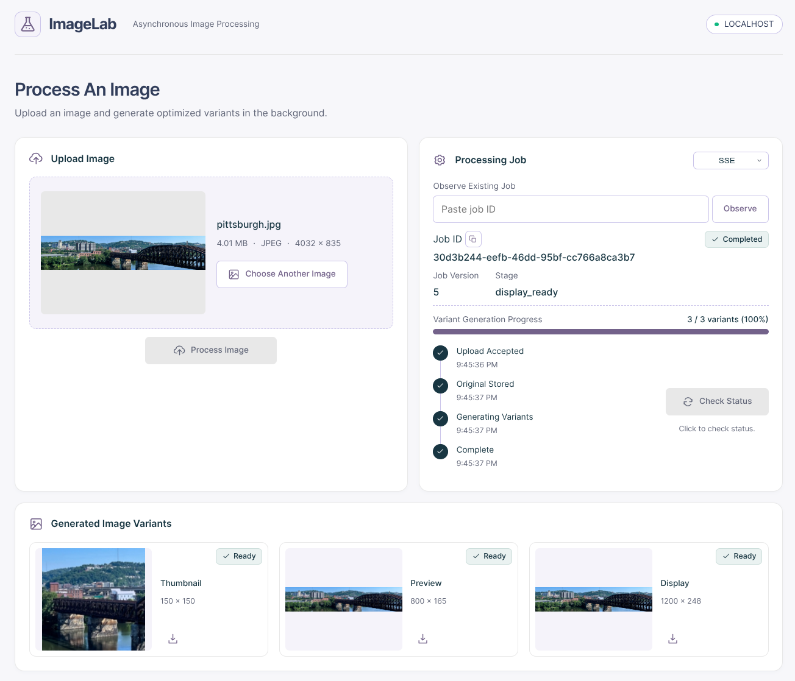
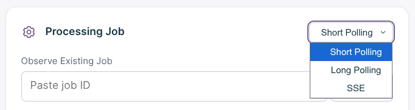

# ImageLab

ImageLab is a single-page application for generating image variants. It generates the following variants:

- thumbnail variant (150px x 150px square, center-cropped)
- preview variant (800px x 600px maximums, within bounds, preserving aspect ratio)
- display variant (1200px x 900px maximums, within bounds, preserving aspect ratio).

It implements 3 different asynchronous application programming interfaces (APIs) and the event emitter pattern. There are three main parts: an API server written in Go (`cmd/api`), a web application using HTML, CSS, and JavaScript (`frontend`), and a PostgreSQL database (`migrations`).



## CMPS4191 Final Project

Reports, presentations, tables, charts, and raw log files can be found in the `/docs` directory, organized by major versions.

| Key                | Value                                                                                              |
| ------------------ | -------------------------------------------------------------------------------------------------- |
| **Student Names**  | [Andres Hung](https://github.com/andreshungbz) & [Jennessa Sierra](https://github.com/jennxsierra) |
| **Student Emails** | 2018118240@ub.edu.bz & 2021153908@ub.edu.bz                                                        |
| **Course**         | CMPS4191 - Advanced Web Technologies                                                               |
| **School**         | University of Belize                                                                               |
| **Due Date**       | November 18, 2026                                                                                  |

## Asynchronous APIs

ImageLab demonstrates the asynchronous APIs of short polling, long polling, and server-sent events. Use the dropdown in the UI to change the mode. Long polling provides an additional dropdown for configuring the wait timer before a 204 No Content response is sent. Manual cancellation is implemented by `AbortController`, and modes can be changed mid-processing without issue. A single job can be simultaneously observed by using the provided input UI.



### Short Polling

Short polling uses the `/v1/jobs/:id` endpoint. By default, it polls every 1 second. It is implemented by a client-side timer that makes a request to the server every second.

### Long Polling

Long polling reuses the `/v1/jobs/:id` endpoint, but requires at least an `after` query parameter to be set. The server will wait for a job update before responding, returning a 204 No Content response if no update occurs and after the configured wait time expires (default is 20 seconds). Long polling is implemented using a timer-and-ticker approach, where the ticker that reads the database fires every 200ms.

### Server-Sent Events (SSE)

SSE uses the `/v1/jobs/:id/events` endpoint. The server will send `job-update` events as a job updates and `: keep-alive` heartbeats every 20 seconds if there are no updates. SSE is implemented using a channel notification system, where a database update triggers a notification to the channel, which the SSE handler then reads to send the event to the client.

## Running the Project

> [!NOTE]
> Example environment variables are used throughout this section for demonstration purposes. In a production environment, they should be changed.

### Docker Compose

If you have Docker installed, the provided `compose.yaml` sets up the database and migrations, the API server, and the web application. Run the following command from the project root directory, then access the URLs on their default ports. The Docker setup isn't designed for measurement tests.

```
docker compose up
```

| Service             | URL                   |
| ------------------- | --------------------- |
| **API Server**      | http://localhost:4000 |
| **Web Application** | http://localhost:5500 |

### Manual Setup

#### Prerequisites

- go
- golang-migrate
- just
- PostgreSQL

#### Database Setup

Log in to your own PostgreSQL database instance as a user with sufficient permissions, and run the following commands to create the necessary database and user.

```
CREATE ROLE imagelab WITH LOGIN PASSWORD 'password';
CREATE DATABASE imagelab;
ALTER DATABASE imagelab OWNER TO imagelab;
```

#### API Server Setup

In the project root directory, set up the environment variables, run the database migrations, and start the API server. By default, the API server will be available at http://localhost:4000.

```
cp .envrc.example .envrc
just db-migrations-up
just run
```

#### Web Application Setup

> [!NOTE]
> Using a host other than `localhost` or a different port other than `5500` requires appropriately setting the `CORS_TRUSTED_ORIGINS` environment variable so that the API server does not block requests from the web application.

Use any HTTP server application such as [nginx](https://nginx.org/en/), [Apache](https://httpd.apache.org/), or [Caddy](https://caddyserver.com/) to serve the static web application files in the `frontend` directory. The [Live Server](https://marketplace.visualstudio.com/items?itemName=ritwickdey.LiveServer) extension for VS Code can also be used, but ensure the workspace is set to the `frontend` directory, not the repository root. Then, the web application will be available at http://localhost:5500.

## Experimentation Configuration

### v1 Measurements

Tests in this version are automated on the client-side. With the API server running, run the `meas-v1-single` and `meas-v1-five` recipes to run the 1-count and 5-count measurements, respectively. For clearer delineation, run the API server with a 3-second image processing delay. The results will be printed to the terminal.

```
just test-wrk-del-3s
```

```
just meas-v1-single
```

```
just meas-v1-five
```

### v2 Measurements

Run the server configured for each experimental condition using defined recipes in the `justfile`. The table below lists each condition and the corresponding recipe using `just`. For Condition C3 and C3-X (which use the same command as C3), configure the appropriate latency in a custom profile in the browser developer tools' network tab. C3 uses 200ms latency, and C3-X uses 400ms latency. Conditions C1, C2, C3, and C3-X show Simulated Progress in the UI.

| Condition | Server Configuration Command |
| --------- | ---------------------------- |
| A         | `just meas-v2-exp-cond-a`    |
| B         | `just meas-v2-exp-cond-b`    |
| C1        | `just meas-v2-exp-cond-c1`   |
| C2        | `just meas-v2-exp-cond-c2`   |
| C3        | `just meas-v2-exp-cond-c3`   |

Submit an image to ImageLab with the browser developer tools open to view the resulting network requests. Timestamps will appear in the browser console and in the server logs. Consolidated results can be viewed by running the following command, assuming the path to the log files is provided.

```
just show-v2-meas
```

### v3 Measurements

Since these measurements reuse the same server configurations as v2, aliases are provided. Conditions A and B map to v2, while Condition C maps to C2 in v2.

| Condition | Server Configuration Command |
| --------- | ---------------------------- |
| A         | `just meas-v3-cond-a`        |
| B         | `just meas-v3-cond-b`        |
| C         | `just meas-v3-cond-c`        |

As with v2, some measurements will be found in the browser console and server logs after submitting an image to ImageLab. Consolidated results can also be viewed.

```
just show-v3-meas
```

## Attributions

- Favicon framed picture icon is copyright 2020 Twitter, Inc., and other contributors. The graphics are licensed under [CC-BY 4.0](https://creativecommons.org/licenses/by/4.0/). No modifications were made to the original image.
- The `/python/src/measurement/pittsburgh.jpg` test image used for measurement tests is copyright 2024 Andres Hung and is licensed under [CC-BY-SA 4.0](https://creativecommons.org/licenses/by-sa/4.0/).
